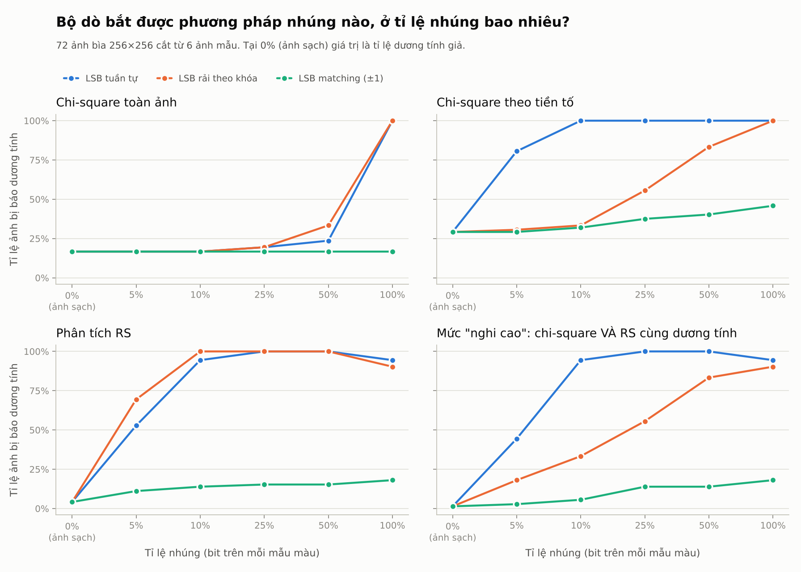
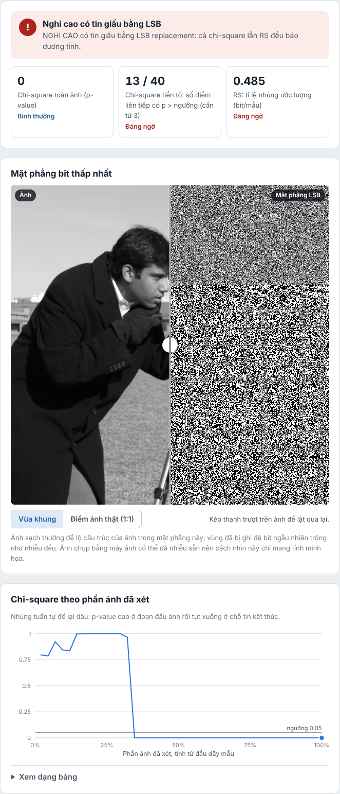
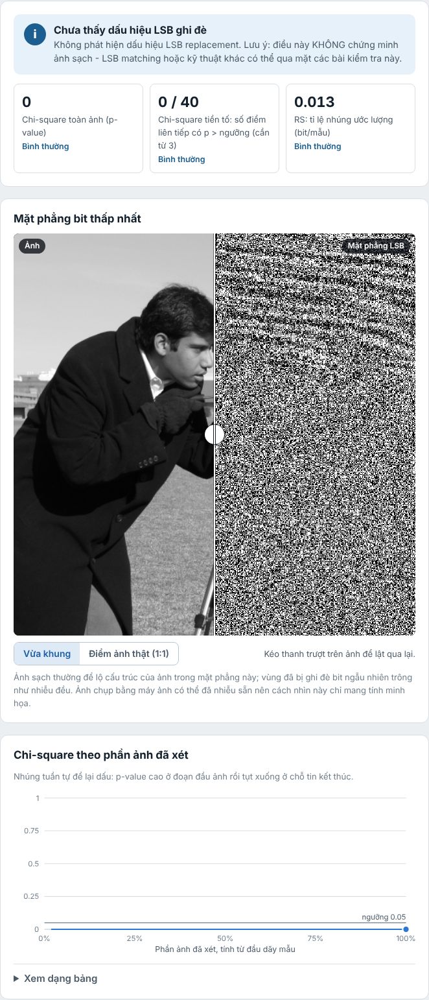
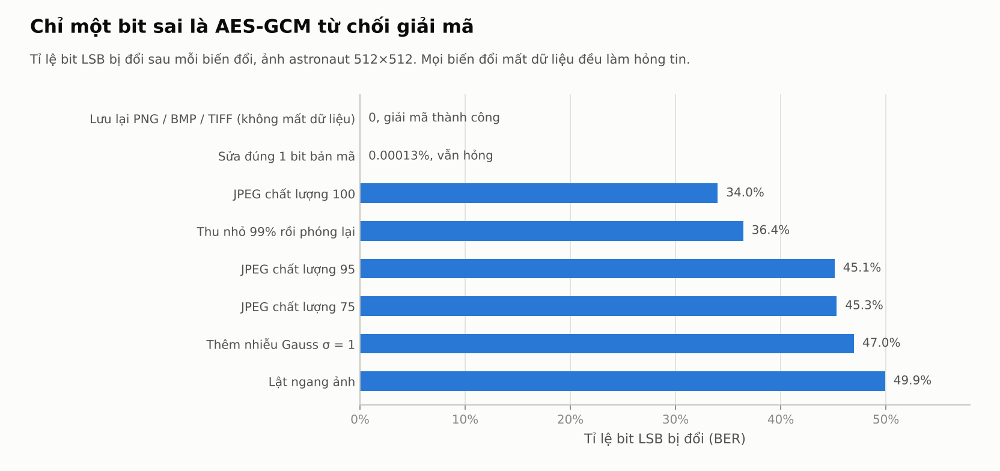
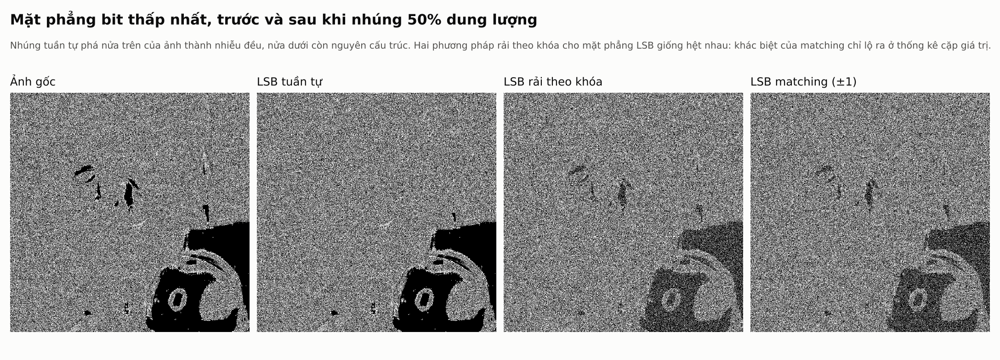
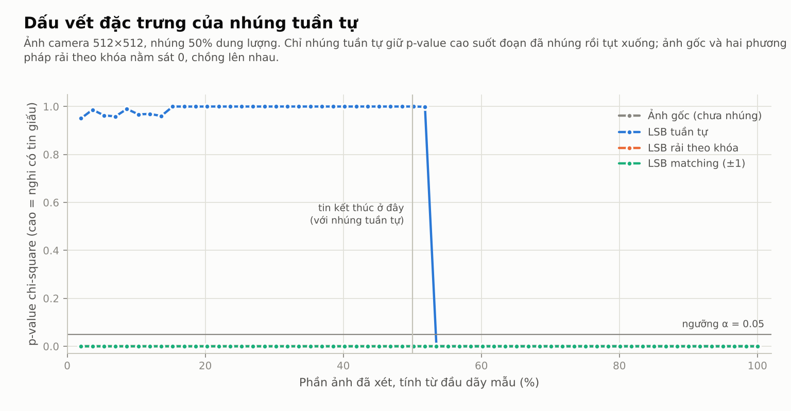
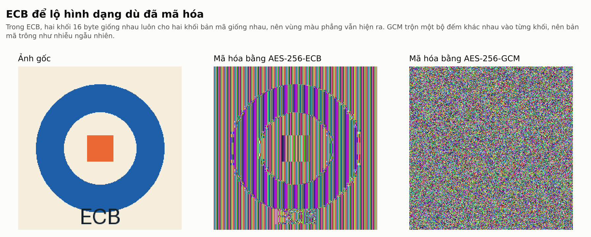

# StegoVault

**Giấu tin mã hóa trong ảnh, và cuộc đua giữa người giấu với người dò.**

Dự án môn _Nhập môn An toàn thông tin_. Sinh viên: `Huỳnh Võ Ngọc Khánh` · MSSV: `24680621` · Lớp: `DHKTPM20A_KSTN`

Dùng kỹ thuật Steganography

StegoVault mã hóa một tin nhắn, một file hoặc nhiều file cùng lúc bằng AES-256-GCM, rồi giấu bản mã vào các bit thấp nhất (LSB) của ảnh PNG.
Điểm khác của đề tài là có thêm **phía người dò**: bộ steganalysis tự cài đặt (chi-square và RS) để đo xem từng
cách giấu bị phát hiện ở mức nào. Vì vậy dự án trả lời được hai câu hỏi thay vì một: giấu thế nào, và giấu như thế có bị lộ không.

Phạm vi môn học mà dự án chạm tới: hàm băm (SHA-256, HMAC), mật mã đối xứng (AES-GCM), dẫn xuất khóa (scrypt, Argon2id),
xác thực và toàn vẹn (thẻ GCM), cùng steganography và steganalysis.

## Kết quả chính

Thí nghiệm trên 72 ảnh bìa 256×256 (cắt từ 6 ảnh mẫu). Số liệu đầy đủ và cách tái tạo ở mục [Thí nghiệm](#thí-nghiệm-và-kết-quả).

1. **Ba cách giấu có chất lượng ảnh như nhau nhưng khả năng bị dò rất khác nhau.** PSNR đo được trùng PSNR lý thuyết
   `10·log10(255² / (r/2))` (sai lệch dưới 0,2 dB), từ 71 dB ở tỉ lệ nhúng 1% xuống 51 dB khi nhúng kín. Mắt thường không phân biệt được, nhưng bộ dò thì có.
2. **LSB tuần tự bị lộ nhanh nhất.** Ở tỉ lệ nhúng 10%, công cụ kết luận "nghi cao" với 94% ảnh. Chi-square theo tiền tố còn chỉ ra
   được _chỗ tin kết thúc_ (hình bậc thang của Westfeld).
3. **LSB matching (±1) là cách khó bị dò nhất trong ba cách.** Khi nhúng từ 10% trở lên, chỉ 6–18% ảnh bị kết luận "nghi cao",
   so với 94–100% của LSB tuần tự và 33–90% của LSB rải theo khóa (riêng RS đơn lẻ bắt LSB rải theo khóa 90–100% ở các mức này). Matching không vô hình: RS vẫn bắt được 11–18% (tỉ lệ dương tính giả là 4%).
4. **Mọi biến đổi làm mất dữ liệu đều phá hủy tin.** JPEG chất lượng 100 đã làm đổi 34% số bit LSB; JPEG 75, nhiễu Gauss nhẹ và đổi kích thước
   đều đẩy tỉ lệ này lên 36–47%. Chỉ cần sai **một** bit, AES-GCM từ chối giải mã (không bao giờ trả ra rác). Hệ quả thực tế: phải gửi nguyên file PNG, không gửi qua kênh nén lại ảnh.
5. **Giới hạn của chi-square được đo chứ không giấu.** Ảnh `chelsea` sạch bị chi-square báo dương tính ở cả 12/12 mảnh, vì bit thấp
   của ảnh này vốn đã nhiễu và cân bằng. Chi-square vì thế có tỉ lệ dương tính giả 17% (toàn ảnh) và 29% (theo tiền tố), trong khi RS chỉ 4%.



## Cài đặt và chạy nhanh

Yêu cầu: Python 3 (chỉ được chạy thử trên 3.13; pip tự chọn bản thư viện hợp với Python của bạn). Chạy từ thư mục gốc của dự án, không cần cài đặt gói. Trên Windows dùng `py` thay cho `python` nếu lệnh `python` không có.

```bash
python -m venv .venv && source .venv/bin/activate      # Windows: .venv\Scripts\activate
pip install -r requirements.txt

python -m stegovault demo          # chạy trọn vòng giấu -> trích -> phân tích, lưu ảnh vào demo_output/
python -m stegovault serve         # mở giao diện web tại http://127.0.0.1:8765
python -m pytest                   # 183 test, khoảng 12 giây
python experiments/run_all.py      # tái tạo toàn bộ biểu đồ và bảng trong results/ (khoảng 35 giây)
python demo/crypto_demos.py        # demo ECB so với GCM, thác lũ SHA-256, tính dễ sửa của CTR
```

### Dòng lệnh

```bash
# giấu tin (mật khẩu được hỏi ẩn; hoặc đặt biến môi trường STEGOVAULT_PASSWORD)
python -m stegovault embed   -i samples/camera.png -o bi_mat.png -m "Hẹn gặp 7h sáng" --method matching
python -m stegovault embed   -i samples/camera.png -o bi_mat.png -f tai_lieu.pdf                # giấu một file
python -m stegovault embed   -i samples/camera.png -o bi_mat.png -f a.pdf b.txt anh.jpg        # giấu nhiều file một lần
python -m stegovault extract -i bi_mat.png                                                     # in tin ra màn hình
python -m stegovault extract -i bi_mat.png -o thu_muc_dich/                                    # lấy file ra (nhiều file: vào thư mục này)

python -m stegovault capacity samples/camera.png                       # dung lượng tối đa của ảnh
python -m stegovault compare  samples/camera.png bi_mat.png            # PSNR, SSIM, số mẫu bị đổi
python -m stegovault analyze  bi_mat.png --report bao_cao.png          # steganalysis + hình báo cáo
```

Ảnh mẫu trong `samples/` (nguồn và giấy phép ở `samples/NGUON_ANH.md`) chỉ để thử. Bạn có thể dùng ảnh PNG, BMP hoặc JPG của riêng mình; ảnh đầu ra luôn là PNG.

Lỗi thường gặp:

| Triệu chứng                                                   | Cách xử lý                                                                                                                     |
| ------------------------------------------------------------- | ------------------------------------------------------------------------------------------------------------------------------ |
| `No module named stegovault`                                  | Chạy lệnh từ thư mục gốc dự án (nơi có `README.md`), không phải từ thư mục con.                                                |
| `No module named numpy` (hoặc `PIL`, `cryptography`, `scipy`) | Chưa cài thư viện hoặc chưa bật môi trường ảo: chạy lại `pip install -r requirements.txt` sau khi kích hoạt `.venv`.           |
| `Address already in use` khi mở giao diện web                 | Cổng 8765 đang bận: `python -m stegovault serve --port 8800`.                                                                  |
| Báo lỗi Argon2id                                              | Thư viện `cryptography` cũ hơn bản 44: dùng `--kdf scrypt` (mặc định) hoặc `pip install -U cryptography`.                      |
| `Không giải mã được`                                          | Sai mật khẩu, ảnh đã bị nén/đổi kích thước/chỉnh sửa, hoặc ảnh không chứa tin. Hãy dùng đúng file PNG do bước giấu tin tạo ra. |

### Giao diện web

Chạy hoàn toàn trên máy bạn (chỉ lắng nghe `127.0.0.1`), ảnh và mật khẩu không rời khỏi máy. Có 4 tab: Giấu tin, Trích xuất, Phân tích, So sánh. Ở tab Giấu tin có thể chọn hoặc kéo thả nhiều file cùng lúc; ở tab Trích xuất, nhiều file lấy ra được tải riêng từng file hoặc cả bộ dưới dạng `.zip`.

| Phân tích: nhúng tuần tự                | Phân tích: LSB matching               |
| --------------------------------------- | ------------------------------------- |
|  |  |

Hai ảnh trên cùng một tin (khoảng 31% dung lượng), cùng ảnh bìa, chỉ khác phương pháp: bên trái bị kết luận "nghi cao" và đường cong chi-square
cho thấy bậc thang tại chỗ tin kết thúc; bên phải không có dấu hiệu nào. Thanh trượt trên ảnh để lật giữa ảnh gốc và mặt phẳng bit thấp nhất.
Đây là một ảnh được chọn để minh họa sự tương phản: kết quả thay đổi theo từng ảnh, xem số liệu tổng hợp ở dưới.

## Cách hoạt động

```
GIẤU TIN
  tin (văn bản hoặc file)
     │  nén zlib (chỉ khi thật sự nhỏ hơn)
     ▼
  gói  [loại | cờ nén | (tên file) | dữ liệu]      (nhiều file: xem bên dưới)
     │  AES-256-GCM      khóa ← KDF(mật khẩu, salt ngẫu nhiên 16 byte)
     ▼
  nonce(12) ‖ bản mã ‖ thẻ xác thực(16)
     │  thêm "bootstrap" = salt(16) ‖ độ dài đã che bằng HMAC(4)
     ▼
  luồng bit trông như ngẫu nhiên
     │  chọn vị trí: tuần tự, hoặc hoán vị giả ngẫu nhiên theo khóa vị trí
     ▼
  ghi vào bit thấp nhất của từng mẫu màu (ghi đè, hoặc cộng/trừ 1)  ──►  ảnh PNG
```

Một lần dẫn xuất khóa cho ra 64 byte, tách làm hai khóa độc lập: **khóa mã hóa** (32 byte, cho AES-GCM) và **khóa vị trí** (32 byte, cho hoán vị và che độ dài).

| Vùng trong luồng mẫu | Nội dung                 | Vị trí                                         |
| -------------------- | ------------------------ | ---------------------------------------------- |
| 160 mẫu đầu          | salt + độ dài đã che     | tuần tự (để người nhận biết cần đọc bao nhiêu) |
| phần còn lại         | nonce + bản mã + thẻ GCM | tuần tự, hoặc rải theo khóa vị trí             |

Những quyết định thiết kế và lý do:

- **Mã hóa trước, giấu sau.** Văn bản thường có quy luật thống kê, bản mã gần như ngẫu nhiên nên khó phân biệt hơn khi nhúng. Quan trọng hơn, an toàn nằm ở khóa chứ không ở việc người khác chưa biết thuật toán (nguyên tắc Kerckhoffs).
- **AES-GCM là mã hóa có xác thực.** Sai mật khẩu hoặc ảnh bị sửa dù một bit đều bị từ chối. Salt và nonce lấy ngẫu nhiên từ `os.urandom` mỗi lần giấu nên không bao giờ dùng lại cặp (khóa, nonce). Salt và độ dài đã che được đưa vào dữ liệu xác thực kèm theo (AAD), nên sửa chúng cũng bị phát hiện.
- **Không có chữ ký nhận dạng.** Không có "magic number" ở dạng rõ, kể cả trường độ dài (che bằng HMAC), nên luồng nhúng không để lộ rằng nó thuộc về công cụ này.
- **KDF tốn bộ nhớ.** scrypt (N=2¹⁵, r=8, p=1: 32 MiB, khoảng 50 ms) hoặc Argon2id (64 MiB, 3 vòng, 4 luồng, khoảng 90 ms; thời gian đo trên máy phát triển) làm chậm việc dò mật khẩu bằng GPU. Mật khẩu được chuẩn hóa Unicode NFKC để "ế" gõ dạng dựng sẵn hay tổ hợp đều ra cùng một khóa.
- **Nhiều file trong một gói.** Một file dùng đúng định dạng cũ; từ hai file trở lên, gói có loại riêng: `[số file (2B)]` rồi mỗi file là `[độ dài tên (2B)][tên][kích thước (4B)][dữ liệu]`, và cả gói được nén một lần. Mọi độ dài đọc từ ảnh đều bị kiểm biên (khai sai hoặc thừa byte thì bị từ chối), tối đa 256 file, tên trùng được đánh số lại ("a.txt", "a (2).txt") nên không file nào ghi đè file nào. Dung lượng được kiểm tra trên cả gói: tổng các file phải vừa với ảnh.
- **Tên file lấy từ ảnh không được tin.** Khi trích file, tên được làm sạch (bỏ đường dẫn, ký tự cấm, tên thiết bị Windows) và có test chặn ghi ra ngoài thư mục đích. Dữ liệu giải nén bị giới hạn kích thước để chống "bom nén".

### Ba phương pháp nhúng

| Phương pháp  | Cách ghi                                       | Vị trí                   | Dấu vết thống kê                                                        |
| ------------ | ---------------------------------------------- | ------------------------ | ----------------------------------------------------------------------- |
| `sequential` | ghi đè LSB                                     | tuần tự từ đầu ảnh       | cặp giá trị (2k, 2k+1) bị cân bằng, dồn vào phần đầu ảnh: dễ bị dò nhất |
| `keyed`      | ghi đè LSB                                     | rải ngẫu nhiên theo khóa | vẫn cân bằng cặp giá trị, nhưng trải đều khắp ảnh                       |
| `matching`   | cộng hoặc trừ 1 (ngẫu nhiên) khi LSB chưa đúng | rải ngẫu nhiên theo khóa | không tạo ra sự cân bằng cặp giá trị; khó bị dò nhất trong ba cách      |

Cả ba đổi cùng số mẫu (khoảng r/2 với tỉ lệ nhúng r) và mỗi mẫu lệch đúng 1 đơn vị, nên chất lượng ảnh như nhau. Hoán vị theo khóa là một mạng Feistel 6 vòng với hàm vòng là AES, kèm "cycle walking" để vẫn là song ánh trên đúng miền ảnh; vì không dùng bộ sinh số ngẫu nhiên của numpy nên người giấu và người nhận khác phiên bản thư viện vẫn khớp vị trí.

## Threat model

**Bảo vệ cái gì.** (1) Bí mật của nội dung tin. (2) Tính toàn vẹn của tin: sửa ảnh thì bị phát hiện. (3) Ở mức hạn chế: việc người khác không nhận ra ảnh có chứa tin.

**Kẻ tấn công được xét tới.**

| Kẻ tấn công                | Biết gì, làm được gì                                             | Kết quả                                                                                         |
| -------------------------- | ---------------------------------------------------------------- | ----------------------------------------------------------------------------------------------- |
| Quan sát thụ động          | Có ảnh đã giấu tin, biết toàn bộ thuật toán, không biết mật khẩu | Không đọc được nội dung (AES-256-GCM). Không xác định được vị trí bit với `keyed` và `matching` |
| Kẻ sửa ảnh                 | Đổi bit trong ảnh                                                | Bị phát hiện, giải mã thất bại (có test sửa đúng 1 bit)                                         |
| Người dò thống kê          | Chạy chi-square, RS trên ảnh                                     | `sequential` và `keyed` bị lộ; `matching` bị lộ ít hơn nhiều (xem số liệu)                      |
| Kẻ dò mật khẩu ngoại tuyến | Có ảnh, thử nhiều mật khẩu                                       | Mỗi lần thử tốn 32–64 MiB bộ nhớ qua KDF; độ mạnh phụ thuộc vào mật khẩu                        |

**Ngoài phạm vi, và cần nói thẳng.**

- **Kênh nén lại ảnh** (mạng xã hội, ứng dụng chat, chụp màn hình): LSB không sống sót. Đây là giới hạn của kỹ thuật, không phải lỗi cài đặt.
- **Steganalysis hiện đại** (đặc trưng SRM, mạng nơ-ron sâu): các bộ dò trong dự án là kỹ thuật cổ điển. LSB matching qua mặt được chúng nhưng không được cho là qua mặt được các bộ dò hiện đại.
- **Kẻ có ảnh gốc ban đầu**: so sánh hai ảnh sẽ chỉ ra chỗ bị đổi, tức là biết có tin. Nội dung vẫn được mã hóa, nhưng sự tồn tại thì lộ. Đừng đăng công khai ảnh bìa gốc.
- **Máy bị nhiễm mã độc, mật khẩu yếu, lộ qua kênh phụ.** Mật khẩu nằm trong bộ nhớ Python trong lúc xử lý và không thể xóa chắc chắn.
- Dự án **chưa được kiểm toán** và dùng cho học tập. Phần hoán vị Feistel là thiết kế riêng của dự án (không phải chuẩn); nếu nó bị phá thì kẻ tấn công biết được _vị trí_ bit, còn nội dung vẫn được AES-GCM bảo vệ.

## Steganalysis (phía người dò)

Ba công cụ, tất cả tự cài đặt trong `stegovault/steganalysis.py`:

- **Mặt phẳng LSB**: nhìn trực tiếp bit thấp nhất. Vùng bị ghi đè trông như nhiễu đều.
- **Chi-square theo cặp giá trị** (Westfeld và Pfitzmann, 2000): sau khi ghi đè LSB bằng bit ngẫu nhiên, hai giá trị 2k và 2k+1 có tần suất gần bằng nhau. Dùng cho toàn ảnh, và theo **tiền tố** tăng dần để thấy bậc thang của nhúng tuần tự. Tiêu chí dương tính của bản theo tiền tố là _chuỗi ít nhất 3 điểm liên tiếp_ có p-value trên ngưỡng 0,05.
- **Phân tích RS** (Fridrich, Goljan, Du, 2001): ước lượng tỉ lệ nhúng qua sự mất đối xứng giữa nhóm "mượt hơn" và "nhiễu hơn" khi lật LSB.

Kết luận của công cụ: **nghi cao** khi cả họ chi-square lẫn RS cùng dương tính, **nghi ngờ** khi chỉ một trong hai, **chưa thấy dấu hiệu** khi không có gì (kèm lời nhắc rằng đây không phải bằng chứng ảnh sạch).

Về độ chính xác của ước lượng RS (đo trên 6 ảnh mẫu, sai số là độ lệch chuẩn giữa các ảnh; bảng đầy đủ trong `results/RESULTS.md`): khi bit giấu rải đều (`keyed`) ước lượng rất sát và ổn định, ví dụ tỉ lệ thật 0,30 cho 0,32 ± 0,01 và 0,80 cho 0,81 ± 0,01. Khi tin dồn vào đầu ảnh (`sequential`), giá trị trung bình vẫn gần đúng (0,31 khi thật là 0,30) nhưng từng ảnh lệch nhiều hơn hẳn (± 0,08). Với `matching`, RS gần như không thấy gì (ước lượng chỉ 0,02–0,05).

## Thí nghiệm và kết quả

Toàn bộ bảng và biểu đồ do `experiments/run_all.py` sinh ra trong `results/` (xem `results/RESULTS.md`), với hạt giống cố định nên chạy lại cho cùng số liệu.

**Thiết kế.** 72 ảnh bìa 256×256 cắt ngẫu nhiên (12 mảnh mỗi ảnh) từ 6 ảnh mẫu. Nhúng _mô phỏng_ bằng bit ngẫu nhiên đều: bản mã AES-GCM
không phân biệt được với bit ngẫu nhiên, nên cho cùng thống kê với nhúng thật mà không tốn thời gian KDF (giả định này có kiểm tra riêng ở [mục 6 của RESULTS.md](results/RESULTS.md)). Ngưỡng đặt cố định theo mặc định của bộ dò. Cột "0%" là ảnh sạch, tức là **tỉ lệ dương tính giả**.

Tỉ lệ ảnh bị kết luận **"nghi cao"** (chi-square và RS cùng dương tính):

| Phương pháp       | 0% (sạch) | 5%  | 10% | 25%  | 50%  | 100% |
| ----------------- | --------- | --- | --- | ---- | ---- | ---- |
| LSB tuần tự       | 1%        | 44% | 94% | 100% | 100% | 94%  |
| LSB rải theo khóa | 1%        | 18% | 33% | 56%  | 83%  | 90%  |
| LSB matching (±1) | 1%        | 3%  | 6%  | 14%  | 14%  | 18%  |

Riêng **RS** (bộ dò đơn lẻ tốt nhất, dương tính giả 4%):

| Phương pháp       | 0% (sạch) | 5%  | 10%  | 25%  | 50%  | 100% |
| ----------------- | --------- | --- | ---- | ---- | ---- | ---- |
| LSB tuần tự       | 4%        | 53% | 94%  | 100% | 100% | 94%  |
| LSB rải theo khóa | 4%        | 69% | 100% | 100% | 100% | 90%  |
| LSB matching (±1) | 4%        | 11% | 14%  | 15%  | 15%  | 18%  |

Quan sát rút ra:

- RS mạnh nhất và ít báo nhầm nhất, nhưng **kém đi ở tỉ lệ nhúng 100%** (90–94%). Chi-square toàn ảnh thì ngược lại: chỉ thật sự bắt được khi nhúng kín (100% ảnh nhúng kín bị bắt); ở 50% mới nhích lên 24–33%, so với 17% dương tính giả.
- Hai họ bộ dò bổ sung cho nhau, nhưng điều kiện "cả hai cùng dương tính" làm `keyed` ở mức nhúng thấp chỉ được xếp "nghi ngờ" chứ chưa "nghi cao" (RS bắt 100% ở 10% nhưng chi-square chưa bắt được).
- Chi-square toàn ảnh trên LSB matching ở mọi mức nhúng đều bằng đúng tỉ lệ dương tính giả (17%): nó hoàn toàn mù trước ±1.

### Độ bền



Chỉ lưu lại bằng PNG, BMP hoặc TIFF là giữ được tin. Mọi biến đổi khác (JPEG chất lượng 100 trở xuống, đổi kích thước 99%, nhiễu Gauss σ=1, lật ngang, cắt bỏ một hàng và một cột) đều làm giải mã thất bại với cả ba phương pháp.

### Hình minh họa

| Mặt phẳng LSB sau khi nhúng 50% | Dấu vết của nhúng tuần tự         |
| ------------------------------- | --------------------------------- |
|      |  |

Hai phương pháp rải theo khóa (`keyed`, `matching`) cho mặt phẳng LSB giống hệt nhau: khác biệt của matching không nằm ở bit thấp nhất mà ở thống kê cặp giá trị.

### Mật mã nền tảng (`demo/crypto_demos.py`)



ECB giữ nguyên hình dạng vì các khối giống nhau cho bản mã giống nhau (180 khối khác nhau trong 12.288 khối, y như ảnh gốc), còn GCM làm cả 12.288 khối đều khác nhau.
Đổi 1 bit đầu vào làm SHA-256 đổi trung bình 127,8/256 bit (49,9%). Bản mã AES-CTR bị lật vài bit đổi được "100.000" thành "900.000" mà người nhận không biết; cùng thao tác trên AES-GCM bị từ chối.

## Hạn chế và những điều cần đọc kỹ khi dùng số liệu

- **Mẫu nhỏ và không độc lập.** 72 mảnh nhưng chỉ đến từ 6 ảnh gốc. Khoảng tin cậy Wilson trong `results/` coi các mảnh là độc lập nên **lạc quan hơn thực tế**. Số liệu mang tính chỉ báo xu hướng, không đủ để kết luận chắc chắn về tỉ lệ dương tính giả ngoài thực tế. Riêng ảnh `chelsea` đóng góp toàn bộ dương tính giả của chi-square toàn ảnh (12/72).
- **Nguyên nhân dương tính giả của chi-square chỉ được suy ra, chưa kiểm chứng.** Giả thuyết hợp lý là các ảnh này đã qua xử lý (nén, đổi kích thước) trước khi vào bộ dữ liệu nên bit thấp vốn đã nhiễu, nhưng dự án không có cách xác nhận.
- **Một quyết định được đưa ra khi đã nhìn dữ liệu.** Tiêu chí chi-square theo tiền tố ban đầu là "p-value lớn nhất trên các điểm vượt ngưỡng"; nó tự sinh dương tính giả (so sánh nhiều lần) nên được đổi thành "chuỗi từ 3 điểm liên tiếp". Việc đổi này diễn ra khi đang xem kết quả trên chính các ảnh mẫu, nên tỉ lệ dương tính giả báo cáo có thể hơi lạc quan. Không có ngưỡng nào khác được tinh chỉnh.
- **Các thí nghiệm lớn dùng nhúng mô phỏng, không phải nhúng thật.** Giả định "bản mã AES-GCM là bit ngẫu nhiên nên cho cùng thống kê" đã được kiểm tra riêng trên 24 mảnh: nhúng thật (KDF mặc định) và mô phỏng lệch nhau tối đa 0,004 ở trung bình RS và 2 mảnh ở số lần gắn cờ, không theo một hướng nhất quán (`experiments/exp_real_vs_sim.py`, mục 6 của `results/RESULTS.md`). Đây là bằng chứng "không thấy khác biệt" trên mẫu nhỏ và hai bộ dò cổ điển, không phải chứng minh hai phân phối trùng nhau. Phần khứ hồi thật được kiểm thử riêng (183 test, gồm cả KDF mặc định).
- **Ảnh `camera` là ảnh xám nhân thành 3 kênh**, không đại diện cho ảnh màu thật.
- **Chỉ hỗ trợ ảnh 8-bit mỗi kênh.** Kênh alpha bị bỏ (có cảnh báo), ảnh 16-bit bị từ chối. Ảnh bìa JPEG được giải nén rồi nhúng, đầu ra luôn là PNG.
- **Không có** phủ nhận hợp lý, nhiều tin độc lập (mỗi tin một mật khẩu) trong cùng một ảnh, hay sửa lỗi (một bit sai là mất cả tin, đó là chủ đích để GCM bảo vệ toàn vẹn). Giấu nhiều file thì cả gói dùng chung một mật khẩu và được mã hóa như một khối: lấy ra là lấy được tất cả hoặc không được file nào.
- **Máy chủ web chỉ dành cho dùng cục bộ.** Có kiểm tra Host, Content-Type, giới hạn kích thước và CSP chặt, nhưng không được thiết kế để mở ra mạng.

## Phần nào tự cài đặt, phần nào dùng thư viện

| Tự cài đặt (phần học thuật của đề tài)                                                         | Dùng thư viện chuẩn (không tự viết mật mã)                                   |
| ---------------------------------------------------------------------------------------------- | ---------------------------------------------------------------------------- |
| LSB replacement và LSB matching (`lsb.py`, `embed.py`, `extract.py`)                           | AES-256-GCM, scrypt, Argon2id: thư viện `cryptography`                       |
| Hoán vị giả ngẫu nhiên theo khóa: Feistel + cycle walking (`permutation.py`)                   | Nén: `zlib` · Đọc/ghi ảnh: `Pillow`                                          |
| Định dạng dữ liệu nhúng, che độ dài, làm sạch tên file (`crypto_layer.py`)                     | Mảng và thống kê: `numpy`, `scipy` (phân phối chi-square, bộ lọc trung bình) |
| Chi-square, chi-square theo tiền tố, phân tích RS (`steganalysis.py`)                          | Vẽ biểu đồ: `matplotlib`                                                     |
| PSNR, SSIM, thống kê khác biệt (`metrics.py`); SSIM được đối chiếu với scikit-image trong test |                                                                              |
| Máy chủ web cục bộ và giao diện (`web/`), bộ thí nghiệm (`experiments/`)                       |                                                                              |

## Cấu trúc thư mục

```
StegoVault/
├── stegovault/            mã nguồn chính
│   ├── crypto_layer.py    KDF, AES-GCM, đóng gói dữ liệu, làm sạch tên file
│   ├── permutation.py     hoán vị Feistel theo khóa (chọn vị trí nhúng)
│   ├── lsb.py             ghi/đọc bit (replace, matching)
│   ├── embed.py  extract.py  image_io.py
│   ├── steganalysis.py    chi-square, RS, mặt phẳng LSB
│   ├── metrics.py         PSNR, SSIM
│   ├── cli.py  __main__.py
│   └── web/               máy chủ cục bộ + giao diện (index.html)
├── experiments/           run_all.py và 4 thí nghiệm
├── demo/crypto_demos.py   ECB so với GCM, thác lũ SHA-256, CTR so với GCM
├── tests/                 183 test (pytest)
├── results/               biểu đồ, bảng, CSV do thí nghiệm sinh ra (RESULTS.md)
├── samples/               ảnh mẫu và NGUON_ANH.md
└── docs/                  KICH_BAN_DEMO.md và ảnh chụp giao diện
```

## Tài liệu tham khảo

1. Westfeld, A., Pfitzmann, A. (2000). _Attacks on Steganographic Systems_. Information Hiding, LNCS 1768.
2. Fridrich, J., Goljan, M., Du, R. (2001). _Detecting LSB Steganography in Color and Gray-Scale Images_. IEEE Multimedia 8(4).
3. Dworkin, M. (2007). _NIST SP 800-38D: Recommendation for Block Cipher Modes of Operation: Galois/Counter Mode (GCM)_.
4. Biryukov, A., Dinu, D., Khovratovich, D., Josefsson, S. (2021). _RFC 9106: Argon2 Memory-Hard Function_. · Percival, C., Josefsson, S. (2016). _RFC 7914: The scrypt Password-Based Key Derivation Function_.
5. Kerckhoffs, A. (1883). _La cryptographie militaire_.
6. Wang, Z., Bovik, A. C., Sheikh, H. R., Simoncelli, E. P. (2004). _Image quality assessment: from error visibility to structural similarity_. IEEE TIP 13(4).

Ảnh mẫu: xem `samples/NGUON_ANH.md`.
