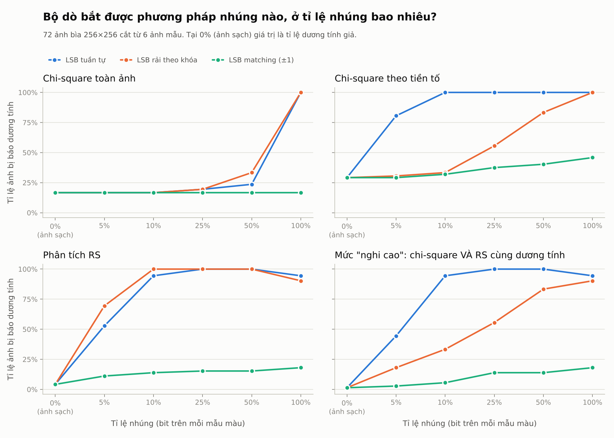
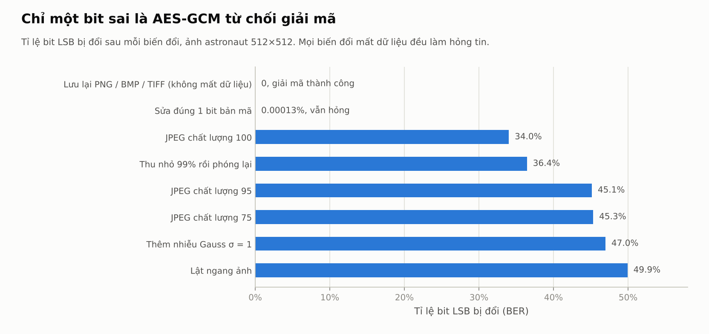
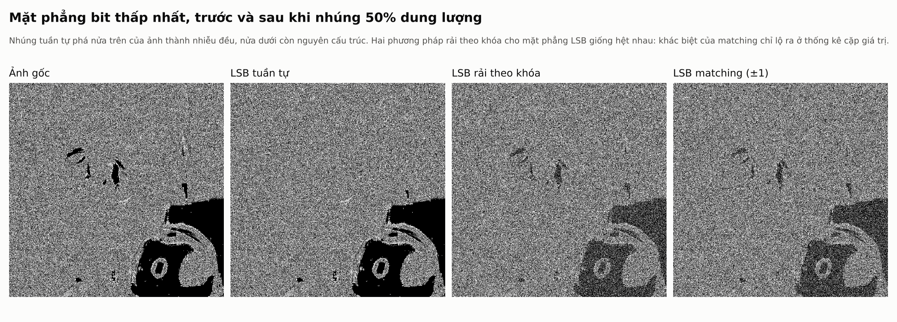
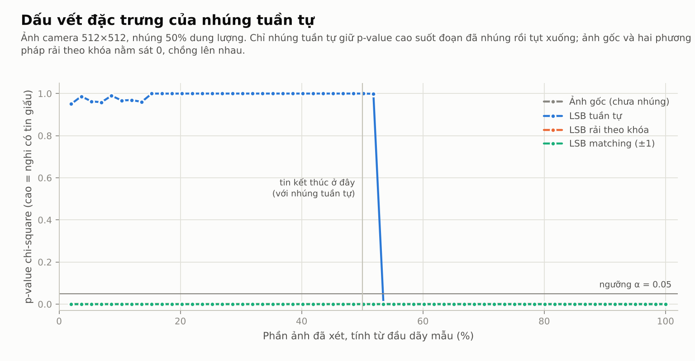
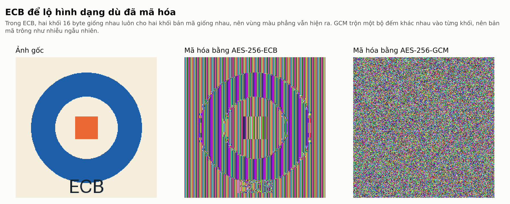

# Kết quả thí nghiệm StegoVault

Sinh tự động bởi `experiments/run_all.py` (đầy đủ). Hạt giống ngẫu nhiên cố định nên chạy lại cho cùng số liệu
(riêng BER ở mục độ bền dao động nhẹ vì salt và nonce của AES-GCM luôn ngẫu nhiên).

## 1. Cuộc đua giữa người giấu và người dò

### Tỉ lệ phát hiện theo phương pháp và tỉ lệ nhúng

Mẫu: 72 ảnh bìa 256×256 (12 mảnh mỗi ảnh mẫu). Số trong ngoặc là khoảng tin cậy Wilson 95%.

**Chi-square toàn ảnh**

| Phương pháp | 0% (sạch) | 5% | 10% | 25% | 50% | 100% |
|---|---|---|---|---|---|---|
| LSB tuần tự | 17% (10%–27%) | 17% (10%–27%) | 17% (10%–27%) | 19% (12%–30%) | 24% (15%–35%) | 100% (95%–100%) |
| LSB rải theo khóa | 17% (10%–27%) | 17% (10%–27%) | 17% (10%–27%) | 19% (12%–30%) | 33% (24%–45%) | 100% (95%–100%) |
| LSB matching (±1) | 17% (10%–27%) | 17% (10%–27%) | 17% (10%–27%) | 17% (10%–27%) | 17% (10%–27%) | 17% (10%–27%) |

**Chi-square theo tiền tố**

| Phương pháp | 0% (sạch) | 5% | 10% | 25% | 50% | 100% |
|---|---|---|---|---|---|---|
| LSB tuần tự | 29% (20%–41%) | 81% (70%–88%) | 100% (95%–100%) | 100% (95%–100%) | 100% (95%–100%) | 100% (95%–100%) |
| LSB rải theo khóa | 29% (20%–41%) | 31% (21%–42%) | 33% (24%–45%) | 56% (44%–66%) | 83% (73%–90%) | 100% (95%–100%) |
| LSB matching (±1) | 29% (20%–41%) | 29% (20%–41%) | 32% (22%–43%) | 38% (27%–49%) | 40% (30%–52%) | 46% (35%–57%) |

**Phân tích RS**

| Phương pháp | 0% (sạch) | 5% | 10% | 25% | 50% | 100% |
|---|---|---|---|---|---|---|
| LSB tuần tự | 4% (1%–12%) | 53% (41%–64%) | 94% (87%–98%) | 100% (95%–100%) | 100% (95%–100%) | 94% (87%–98%) |
| LSB rải theo khóa | 4% (1%–12%) | 69% (58%–79%) | 100% (95%–100%) | 100% (95%–100%) | 100% (95%–100%) | 90% (81%–95%) |
| LSB matching (±1) | 4% (1%–12%) | 11% (6%–20%) | 14% (8%–24%) | 15% (9%–25%) | 15% (9%–25%) | 18% (11%–28%) |

**Mức "nghi cao": chi-square VÀ RS cùng dương tính**

| Phương pháp | 0% (sạch) | 5% | 10% | 25% | 50% | 100% |
|---|---|---|---|---|---|---|
| LSB tuần tự | 1% (0%–7%) | 44% (34%–56%) | 94% (87%–98%) | 100% (95%–100%) | 100% (95%–100%) | 94% (87%–98%) |
| LSB rải theo khóa | 1% (0%–7%) | 18% (11%–28%) | 33% (24%–45%) | 56% (44%–66%) | 83% (73%–90%) | 90% (81%–95%) |
| LSB matching (±1) | 1% (0%–7%) | 3% (1%–10%) | 6% (2%–13%) | 14% (8%–24%) | 14% (8%–24%) | 18% (11%–28%) |

**Mức "nghi ngờ" trở lên: ít nhất một bộ dò dương tính**

| Phương pháp | 0% (sạch) | 5% | 10% | 25% | 50% | 100% |
|---|---|---|---|---|---|---|
| LSB tuần tự | 32% (22%–43%) | 89% (80%–94%) | 100% (95%–100%) | 100% (95%–100%) | 100% (95%–100%) | 100% (95%–100%) |
| LSB rải theo khóa | 32% (22%–43%) | 82% (72%–89%) | 100% (95%–100%) | 100% (95%–100%) | 100% (95%–100%) | 100% (95%–100%) |
| LSB matching (±1) | 32% (22%–43%) | 38% (27%–49%) | 40% (30%–52%) | 39% (28%–50%) | 42% (31%–53%) | 46% (35%–57%) |

**Dương tính giả theo ảnh gốc (ảnh sạch)**

| Ảnh gốc | Chi-square toàn ảnh | Chi-square theo tiền tố | Phân tích RS | Mức "nghi cao": chi-square VÀ RS cùng dương tính | Mức "nghi ngờ" trở lên: ít nhất một bộ dò dương tính |
|---|---|---|---|---|---|
| astronaut | 0/12 | 6/12 | 1/12 | 0/12 | 7/12 |
| camera | 0/12 | 0/12 | 0/12 | 0/12 | 0/12 |
| coffee | 0/12 | 3/12 | 1/12 | 0/12 | 4/12 |
| chelsea | 12/12 | 12/12 | 1/12 | 1/12 | 12/12 |
| rocket | 0/12 | 0/12 | 0/12 | 0/12 | 0/12 |
| retina | 0/12 | 0/12 | 0/12 | 0/12 | 0/12 |

## 2. Chất lượng ảnh, dung lượng và chi phí KDF

### Chất lượng ảnh theo tỉ lệ nhúng

Trung bình trên 6 ảnh mẫu 8-bit (PSNR / SSIM). Cột lý thuyết: PSNR = 10·log10(255² / (r/2)).

| Tỉ lệ nhúng r | PSNR lý thuyết (dB) | LSB tuần tự | LSB rải theo khóa | LSB matching (±1) |
|---|---|---|---|---|
| 0.01 | 71.14 | 71.07 dB / 0.99997 | 70.99 dB / 0.99995 | 71.06 dB / 0.99995 |
| 0.05 | 64.15 | 64.14 dB / 0.99974 | 64.13 dB / 0.99976 | 64.13 dB / 0.99976 |
| 0.10 | 61.14 | 61.14 dB / 0.99946 | 61.14 dB / 0.99952 | 61.13 dB / 0.99952 |
| 0.25 | 57.16 | 57.16 dB / 0.99865 | 57.15 dB / 0.99879 | 57.16 dB / 0.99879 |
| 0.50 | 54.15 | 54.15 dB / 0.99747 | 54.15 dB / 0.99753 | 54.15 dB / 0.99752 |
| 1.00 | 51.14 | 51.14 dB / 0.99488 | 51.14 dB / 0.99488 | 51.14 dB / 0.99482 |

### Dung lượng giấu tin tối đa

| Ảnh | Kích thước | Số mẫu LSB | Dung lượng tối đa (byte) | ≈ |
|---|---|---|---|---|
| astronaut | 512×512 | 786,432 | 98,256 | 96.0 KiB |
| camera | 512×512 | 786,432 | 98,256 | 96.0 KiB |
| coffee | 600×400 | 720,000 | 89,952 | 87.8 KiB |
| chelsea | 451×300 | 405,900 | 50,689 | 49.5 KiB |
| rocket | 640×427 | 819,840 | 102,432 | 100.0 KiB |
| retina | 640×640 | 1,228,800 | 153,552 | 150.0 KiB |

### Chi phí hàm làm chậm mật khẩu (KDF)

| KDF | Bộ nhớ | Thời gian một lần suy dẫn (trung vị 3 lần) |
|---|---|---|
| scrypt | 32 MiB | 71 ms |
| argon2id | 64 MiB | 71 ms |

### Độ chính xác của ước lượng RS

Tỉ lệ nhúng do RS ước lượng (trung bình ± độ lệch chuẩn giữa 6 ảnh mẫu). Đúng tuyệt đối khi bằng cột đầu tiên; với matching, RS gần như không thấy gì nên ước lượng xấp xỉ 0.

| Tỉ lệ nhúng thật | LSB tuần tự | LSB rải theo khóa | LSB matching (±1) |
|---|---|---|---|
| 0.10 | 0.12 ± 0.03 | 0.12 ± 0.01 | 0.02 ± 0.02 |
| 0.30 | 0.31 ± 0.08 | 0.32 ± 0.01 | 0.03 ± 0.05 |
| 0.50 | 0.46 ± 0.10 | 0.52 ± 0.01 | 0.05 ± 0.08 |
| 0.80 | 0.73 ± 0.08 | 0.81 ± 0.01 | 0.05 ± 0.11 |

## 3. Độ bền trước các biến đổi ảnh

### Độ bền của ảnh đã giấu tin

Tin 1,420 byte giấu vào ảnh astronaut 512×512. OK = giải mã đúng; HỎNG = AES-GCM từ chối. BER = tỉ lệ bit LSB của toàn ảnh bị đổi so với ảnh đã giấu tin (trung bình 3 phương pháp).

| Biến đổi | LSB tuần tự | LSB rải theo khóa | LSB matching (±1) | BER |
|---|---|---|---|---|
| Lưu lại PNG / BMP / TIFF (không mất dữ liệu) | OK | OK | OK | 0 |
| JPEG chất lượng 100 | HỎNG | HỎNG | HỎNG | 34.01% |
| JPEG chất lượng 95 | HỎNG | HỎNG | HỎNG | 45.13% |
| JPEG chất lượng 75 | HỎNG | HỎNG | HỎNG | 45.32% |
| Thu nhỏ 99% rồi phóng lại | HỎNG | HỎNG | HỎNG | 36.44% |
| Thêm nhiễu Gauss σ = 1 | HỎNG | HỎNG | HỎNG | 46.97% |
| Lật ngang ảnh | HỎNG | HỎNG | HỎNG | 49.92% |
| Cắt bỏ 1 hàng và 1 cột mép | HỎNG | HỎNG | HỎNG | — |
| Sửa đúng 1 bit LSB của bản mã | HỎNG | HỎNG | HỎNG | 0.00013% |

## 4. Nhìn trực tiếp vào dấu vết

## 5. Mật mã nền tảng

### Demo mật mã nền tảng

**1. ECB lộ hình dạng, GCM thì không**

- Số khối 16 byte khác nhau: ảnh gốc 180/12,288, ECB 180/12,288, GCM 12,288/12,288.
- ECB giữ nguyên số khối khác nhau của ảnh gốc (chỉ đổi tên khối), GCM làm mọi khối khác nhau.

**2. Hiệu ứng thác lũ của SHA-256**

- Đổi 1 bit trong thông điệp 64 byte, 2,000 lần thử: số bit băm thay đổi trung bình 127.8/256 (49.9%), độ lệch chuẩn 8.1, nhỏ nhất 100, lớn nhất 155.
- Ví dụ: SHA-256("StegoVault") = `4ba3ac44710702efa09e89e191f753c2…` và SHA-256("StegoVaulT") = `59e76c10e8c5ac43a99e98d33a072a76…` (chỉ khác một ký tự).

**3. Bản mã không xác thực có thể bị sửa (CTR) so với GCM**

- Bản rõ gốc: `Chuyen khoan: 100.000 VND cho Lan`
- AES-CTR sau khi kẻ tấn công lật vài bit: `Chuyen khoan: 900.000 VND cho Lan`. Người nhận không phát hiện được gì.
- AES-GCM với đúng thao tác đó: bị từ chối (InvalidTag).

## 6. Kiểm tra giả định của các thí nghiệm: nhúng thật so với mô phỏng

### Nhúng thật so với nhúng mô phỏng

24 mảnh 256×256, nhúng thật (AES-256-GCM, KDF mặc định) và nhúng mô phỏng trên cùng từng mảnh. Mỗi ô có dạng thật / mô phỏng.

| Phương pháp | Tỉ lệ nhúng | RS ước lượng (trung bình) | |Δ RS| mỗi mảnh (trung bình) | Chi-square gắn cờ (/24) | Kết luận "nghi cao" (/24) |
|---|---|---|---|---|---|
| LSB tuần tự | 0.1 | 0.103 / 0.098 | 0.008 | 4 / 4 | 22 / 22 |
| LSB tuần tự | 0.3 | 0.300 / 0.301 | 0.011 | 4 / 4 | 24 / 24 |
| LSB tuần tự | 0.5 | 0.491 / 0.491 | 0.013 | 7 / 6 | 24 / 24 |
| LSB rải theo khóa | 0.1 | 0.111 / 0.112 | 0.008 | 4 / 4 | 10 / 10 |
| LSB rải theo khóa | 0.3 | 0.315 / 0.317 | 0.013 | 5 / 6 | 15 / 15 |
| LSB rải theo khóa | 0.5 | 0.515 / 0.515 | 0.023 | 9 / 10 | 22 / 23 |
| LSB matching (±1) | 0.1 | 0.009 / 0.012 | 0.010 | 4 / 4 | 0 / 0 |
| LSB matching (±1) | 0.3 | 0.015 / 0.015 | 0.020 | 4 / 4 | 1 / 3 |
| LSB matching (±1) | 0.5 | 0.016 / 0.019 | 0.013 | 5 / 4 | 3 / 3 |

Chênh lệch lớn nhất giữa hai cách: 0.004 ở trung bình RS, 2 mảnh ở số lần gắn cờ. Chênh lệch từng mảnh (cột |Δ RS|) khác 0 vì mỗi lần nhúng dùng bit ngẫu nhiên khác nhau; điều cần xem là trung bình và số lần gắn cờ có lệch hệ thống hay không.
